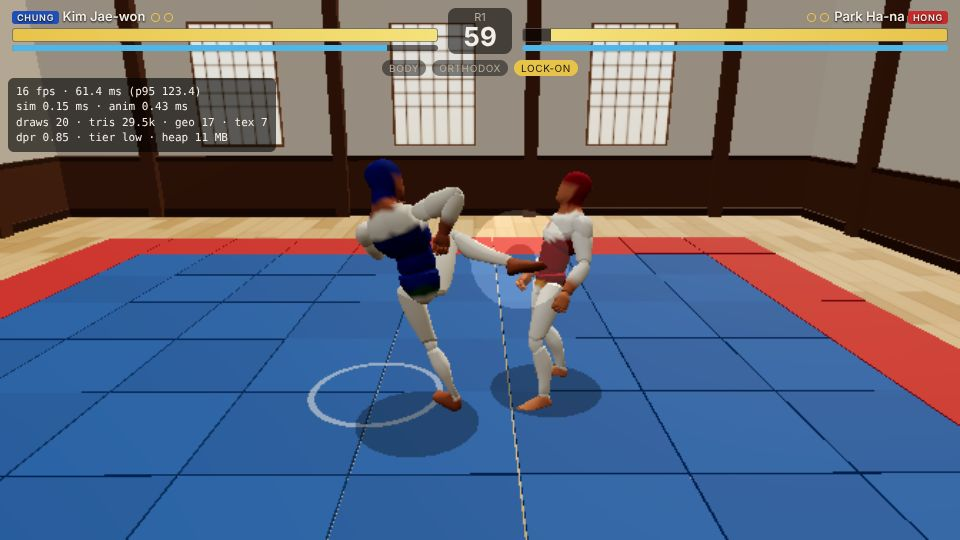

# DOJANG 도장

A semi-realistic 3D Taekwondo sparring game for desktop and mobile browsers. Built with TypeScript, React, Vite, Three.js and React Three Fiber.



## Status

**Phases 0, 1 and 1.5 are done** (Phase 1.5 refined the animation and the mobile controls and HUD after UAT; see [docs/PHASE_1_5.md](docs/PHASE_1_5.md)). You can spar a full arcade match against an AI in a 3D dojang using keyboard, gamepad or touch controls. See [docs/HANDOFF.md](docs/HANDOFF.md) for exactly what works, what was tested and what comes next.

| Works now | Planned |
|---|---|
| Footwork, dash, stance switch, guard | Competitive WT-style point scoring (Phase 2) |
| Front, roundhouse, side and back kicks, straight punch, head/body targeting | Tuned AI difficulty and counterattack depth (Phase 2) |
| Planted footwork, varied idle, outcome-aware kicks, procedural reactions | |
| Compact and Classic touch schemes, slim HUD, optional fullscreen PWA | |
| Frame data (startup/active/recovery), stamina, counter hits, hit stop, combos on hit | Touch gestures and hybrid control mode (Phase 3) |
| Distance-aware hit detection, hit reactions, KO | Training drills and belt progression (Phase 4) |
| Arcade rules: health, 60 s rounds, best of 3, result and rematch | Character select, menus polish, onboarding (Phase 4–5) |
| Three AI presets (first pass), lock-on and free camera | Real-device performance validation (Phase 6) |
| Keyboard, gamepad, multitouch joystick and buttons, portrait prompt | |

## Run it

```bash
npm install
```

```bash
npm run dev
```

Open the printed URL. On a phone on the same network, use the `--host` address that Vite prints.

```bash
npm run build && npm run preview
```

### Controls

- **Keyboard:** `WASD` move (camera-relative; in the default side view `D` steps toward the opponent), `Shift` dash, `J` punch, `K` front kick, `L` roundhouse, `U` side kick, `I` back kick, hold `E` for head height, hold `Space` to guard, `Q` switch stance, `Tab` lock-on, mouse drag or wheel for the camera, `Esc` pause, `` ` `` perf overlay.
- **Touch (Compact, default):** floating joystick on the left; **Kick** repeats the selected kick, and sliding from it opens a technique wheel (release on Front/Round/Side/Back; slide past the outer ring for head height); Guard (hold), Dash, Punch, ⇄ stance switch and a Body/Head chip; drag anywhere else to orbit the camera. **Classic** (one button per technique) is in Settings or the pause menu.
- **Gamepad:** left stick move, right stick camera, X/A/B/Y/RB techniques, LB guard, RT head, LT dash.

### Useful URL parameters

| Parameter | Effect |
|---|---|
| `?start=easy\|normal\|hard` | Skip the menu and start a match |
| `?ai=off` | Opponent stands still (testing) |
| `?perf=1` | Show the performance overlay |
| `?touch=1` | Force touch controls on desktop |
| `?lab=poses&view=side\|front\|quarter` | Animation contact sheet for reviewing the kicks |
| `?lab=motion` | Filmstrips of scripted exchanges (footwork, landed, blocked and missed kicks, reactions) |

## Tests

```bash
npm test
```

Unit tests for frame data, the attack state machine, hit detection, guard, counter hits, match flow, AI, IK and input.

```bash
npm run build && npm run preview
```

Then, in a second terminal:

```bash
node scripts/e2e.mjs http://localhost:4173/ --shots docs/media
```

Browser end-to-end checks in headless Chromium: desktop keyboard play, an exchange against the AI, the result and rematch flow, multitouch on a mobile viewport, and the portrait prompt.

## Assets

The fighter mesh, skeleton and hit/knockdown/idle clips are from Quaternius's **Universal Animation Library** (CC0). The Taekwondo techniques and footwork are original procedural animation. The environment, textures and sounds are generated in code. Full provenance is in [docs/ASSET_MANIFEST.md](docs/ASSET_MANIFEST.md). Rebuild the optimized character with `npm run assets:build`.

## Docs

[Game design](docs/GAME_DESIGN.md) · [Architecture](docs/ARCHITECTURE.md) · [Implementation plan](docs/IMPLEMENTATION_PLAN.md) · [Asset manifest](docs/ASSET_MANIFEST.md) · [Performance](docs/PERFORMANCE.md) · [Decisions](docs/DECISIONS.md) · [Handoff](docs/HANDOFF.md)

DOJANG is a game. Its rules and belt milestones are game systems, not official World Taekwondo rules or grading.
